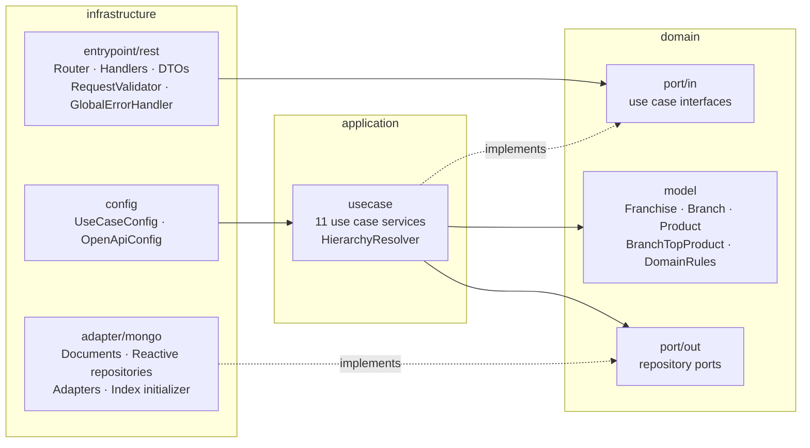
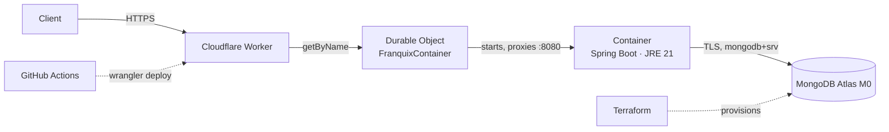

# Franquix — Franchiser as a Service

Reactive REST API for running franchise networks: **franchises → branches → products with stock**.
It is built with Java 21, Spring Boot 3 functional WebFlux and a hexagonal architecture, and it
persists to MongoDB Atlas.

- Create franchises, branches and products, rename all three, update stock and delete products.
- Get the **product with the most stock in each branch** of a franchise.
- Validation, with RFC 7807 `ProblemDetail` errors (400 / 404 / 409).
- Tests with JUnit 5, StepVerifier, WebTestClient, Testcontainers, ArchUnit and BlockHound.
  JaCoCo fails the build below 80 % line or branch coverage.
- Multi-stage Docker image and docker-compose.
- Terraform for MongoDB Atlas M0, deployment to Cloudflare Containers, and GitHub Actions CI/CD.

---

## Contents

1. [Architecture](#architecture)
2. [Technical decisions](#technical-decisions)
3. [Prerequisites](#prerequisites)
4. [Run locally](#run-locally)
5. [Configuration](#configuration)
6. [API](#api)
7. [Tests and coverage](#tests-and-coverage)
8. [Provision MongoDB Atlas with Terraform](#provision-mongodb-atlas-with-terraform)
9. [Deploy to Cloudflare Containers](#deploy-to-cloudflare-containers)
10. [CI/CD](#cicd)
11. [Project structure](#project-structure)

---

## Architecture

### Hexagonal layers



- The **domain** has no framework imports: no Spring, MongoDB or Jakarta. Its models are immutable
  records whose invariants are enforced in their constructors.
- The **application** layer holds the use cases. They are plain classes, registered as beans in
  `infrastructure/config`, so no `@Service` appears outside infrastructure.
- The **infrastructure** layer holds the driving adapter (functional REST) and the driven adapter
  (reactive MongoDB). Explicit mappers convert DTO ↔ domain ↔ document.
- `HexagonalArchitectureTest` (ArchUnit) fails the build if these dependency rules are broken.

### Deployment



---

## Technical decisions

| Topic | Decision | Why |
|---|---|---|
| Web stack | WebFlux **Router Functions + Handlers** | A functional, non-blocking request path that works end to end with the reactive MongoDB driver. |
| Reactivity | `Mono`/`Flux` in every layer, verified by **BlockHound** in all tests | Any blocking call on an event-loop thread fails the suite. The only blocking call in the app is the one-time index creation on the main thread at startup. |
| Persistence model | Three collections with references: `franchises`, `branches`, `products` | Each write touches one small document, so writes are atomic without transactions. Documents never grow without bound. The top-stock query is a single indexed lookup per branch. |
| References | `franchiseId` / `branchId` stored as `ObjectId` | Consistent with `_id`, compact, and correctly indexed. |
| Uniqueness | **Unique indexes** `(name)`, `(franchiseId, name)`, `(branchId, name)` | The database enforces the rule, so two concurrent requests cannot create duplicates. `DuplicateKeyException` maps to `409`. |
| Indexes | Created at startup by `MongoIndexInitializer` (idempotent) | They exist in every environment, including tests, without relying on `auto-index-creation`. |
| Top-stock query | `Flux` of branches (sorted by name) → `flatMapSequential` → `findFirstByBranchIdOrderByStockDescNameAsc` | Each lookup uses the `(branchId, stock desc, name asc)` index and reads one document. Lookups run concurrently, but results keep the branch order. This is simpler to read and test than a `$lookup/$group` aggregation, and the number of branches per franchise is small. |
| Ties | Same stock → **product name ascending** | Deterministic results. |
| Empty branches | **Omitted** from the top-stock result | The endpoint returns products. A branch without products has nothing to report. |
| Hierarchy | Every route resolves `franchise → branch → product` and returns `404` on any mismatch | A product cannot be reached through another franchise's path. |
| Validation | Bean Validation on DTOs (called explicitly, because `@Valid` does not apply to functional endpoints), plus domain invariants (trim, 1–100 chars, stock ≥ 0) | The request layer reports per-field errors, and the domain stays correct no matter which adapter calls it. |
| Errors | One `ErrorWebExceptionHandler` that always returns `application/problem+json` | Responses have the same shape everywhere, and 500 responses never expose internal details. |
| Timestamps | `Clock` ticking in milliseconds | Responses match what MongoDB stores, and tests use a fixed clock. |
| Single module | One Gradle module, with layers enforced by ArchUnit | The project is small; multiple modules would add build overhead for little gain. |
| Cloud | MongoDB Atlas **M0 (free)** + **Cloudflare Containers** | AWS has no permanent free tier for an always-available container. Atlas M0 is free. Cloudflare Containers needs the Workers Paid plan ($5/month), see [cost](#cost). |

---

## Prerequisites

| Tool | Needed for |
|---|---|
| Docker (Desktop) | `docker compose`, Testcontainers in the test suite, building the image |
| JDK 17+ | Running Gradle. A JDK 21 toolchain is downloaded automatically if missing. |
| Terraform ≥ 1.6 | Provisioning Atlas (optional) |
| Node.js 20+ | Cloudflare deployment (optional) |
| MongoDB Atlas account (free) | Cloud database (optional) |
| Cloudflare account on Workers Paid | Cloud deployment (optional) |

---

## Run locally

### Option A — everything in Docker

```bash
docker compose up --build
```

This starts MongoDB 7 (with a named volume) and the API on **http://localhost:8080**. The API
waits until MongoDB is healthy before starting.

```bash
docker compose down        # stop
docker compose down -v     # stop and delete the data
```

### Option B — MongoDB in Docker, API with Gradle

```bash
docker compose up -d mongo
./gradlew bootRun          # profile "local" -> mongodb://localhost:27017/franquix
```

On Windows PowerShell or cmd, use `gradlew.bat bootRun`.

### Useful URLs

| URL | What |
|---|---|
| http://localhost:8080/swagger-ui.html | Swagger UI |
| http://localhost:8080/v3/api-docs | OpenAPI document |
| http://localhost:8080/actuator/health | Health check |

---

## Configuration

All configuration comes from environment variables. See [`.env.example`](.env.example).

| Variable | Default | Description |
|---|---|---|
| `MONGODB_URI` | `mongodb://localhost:27017/franquix` in profile `local`; **required** in `prod` | MongoDB connection string |
| `MONGODB_DATABASE` | `franquix` | Database name |
| `SPRING_PROFILES_ACTIVE` | `local` (`prod` in the Docker image) | `local`: debug logging. `prod`: health details hidden and forwarded headers trusted. |
| `PORT` | `8080` | HTTP port |

Credentials are never stored in the repository. `.env`, `.dev.vars`, `*.tfvars` and Terraform
state are git-ignored.

---

## API

Base path: `/api/v1/franchises`. Ids are MongoDB ObjectIds (24 hex characters).

| # | Method | Path | Body | Success |
|---|---|---|---|---|
| 1 | POST | `/franchises` | `{"name"}` | 201 + `Location` |
| 2 | GET | `/franchises/{franchiseId}` | – | 200 (franchise → branches → products) |
| 3 | PATCH | `/franchises/{franchiseId}/name` | `{"name"}` | 200 |
| 4 | POST | `/franchises/{franchiseId}/branches` | `{"name"}` | 201 + `Location` |
| 5 | PATCH | `/franchises/{franchiseId}/branches/{branchId}/name` | `{"name"}` | 200 |
| 6 | POST | `/franchises/{franchiseId}/branches/{branchId}/products` | `{"name","stock"}` | 201 + `Location` |
| 7 | PATCH | `/franchises/{franchiseId}/branches/{branchId}/products/{productId}/stock` | `{"stock"}` | 200 |
| 8 | PATCH | `/franchises/{franchiseId}/branches/{branchId}/products/{productId}/name` | `{"name"}` | 200 |
| 9 | DELETE | `/franchises/{franchiseId}/branches/{branchId}/products/{productId}` | – | 204 |
| 10 | GET | `/franchises/{franchiseId}/branches/top-stock-products` | – | 200 |

Business rules:

- Names are trimmed and must be 1–100 characters long, not blank. Stock is an integer ≥ 0.
- Franchise names are unique globally. Branch names are unique within their franchise, and
  product names within their branch. A duplicate returns **409**.
- A branch must belong to the franchise in the path, and a product to the branch. Otherwise
  the API returns **404**.

### Walkthrough with curl

These examples use bash (Git Bash on Windows) and `jq` to capture ids. Without `jq`, copy the
`id` from each response by hand. [`docs/requests.http`](docs/requests.http) has the same flow for
the IntelliJ or VS Code REST clients.

```bash
API=http://localhost:8080/api/v1/franchises
JSON='Content-Type: application/json'

# 1. Create a franchise
FRANCHISE=$(curl -s -X POST $API -H "$JSON" -d '{"name":"Acme Coffee"}' | jq -r .id)

# 4. Add branches
CENTRO=$(curl -s -X POST $API/$FRANCHISE/branches -H "$JSON" -d '{"name":"Centro"}' | jq -r .id)
NORTE=$(curl -s -X POST $API/$FRANCHISE/branches -H "$JSON" -d '{"name":"Norte"}' | jq -r .id)

# 6. Add products
COFFEE=$(curl -s -X POST $API/$FRANCHISE/branches/$CENTRO/products -H "$JSON" \
  -d '{"name":"Coffee","stock":120}' | jq -r .id)
curl -s -X POST $API/$FRANCHISE/branches/$CENTRO/products -H "$JSON" -d '{"name":"Tea","stock":40}'
curl -s -X POST $API/$FRANCHISE/branches/$NORTE/products -H "$JSON" -d '{"name":"Bagel","stock":85}'

# 10. Top-stock product per branch
curl -s $API/$FRANCHISE/branches/top-stock-products
```

```json
[
  { "branchId": "…", "branchName": "Centro", "productId": "…", "productName": "Coffee", "stock": 120 },
  { "branchId": "…", "branchName": "Norte",  "productId": "…", "productName": "Bagel",  "stock": 85 }
]
```

```bash
# 7. Update stock
curl -s -X PATCH $API/$FRANCHISE/branches/$CENTRO/products/$COFFEE/stock -H "$JSON" -d '{"stock":15}'

# 8. Rename a product
curl -s -X PATCH $API/$FRANCHISE/branches/$CENTRO/products/$COFFEE/name -H "$JSON" -d '{"name":"Espresso"}'

# 5. Rename a branch
curl -s -X PATCH $API/$FRANCHISE/branches/$CENTRO/name -H "$JSON" -d '{"name":"Downtown"}'

# 3. Rename the franchise
curl -s -X PATCH $API/$FRANCHISE/name -H "$JSON" -d '{"name":"Acme Coffee Global"}'

# 2. Whole tree (branches and products sorted by name)
curl -s $API/$FRANCHISE

# 9. Delete a product (204, empty body)
curl -s -o /dev/null -w '%{http_code}\n' -X DELETE $API/$FRANCHISE/branches/$CENTRO/products/$COFFEE
```

### Errors

Every error is `application/problem+json`:

```bash
curl -s -X POST $API -H "$JSON" -d '{"name":"Acme Coffee Global"}'   # duplicate
```

```json
{
  "type": "about:blank",
  "title": "Conflict",
  "status": 409,
  "detail": "A franchise named 'Acme Coffee Global' already exists",
  "instance": "/api/v1/franchises",
  "timestamp": "2026-10-03T15:33:49.204Z"
}
```

| Status | When |
|---|---|
| 400 | Blank or too-long name, missing or negative stock (`errors` lists each field), malformed JSON, invalid ObjectId |
| 404 | Unknown franchise, branch or product, a path whose parts don't belong together, or an unknown route |
| 409 | Duplicate name within its scope |
| 415 | Body that is not JSON |
| 500 | Unexpected error. The response contains only a generic message; the cause is logged. |

---

## Tests and coverage

```bash
./gradlew build          # compile, all tests, JaCoCo report + 80 % gate
./gradlew test           # tests only
```

Docker must be running, because Testcontainers starts `mongo:7.0`.

| Suite | Scope | Tools |
|---|---|---|
| `domain/**` | Model invariants, exception messages | JUnit 5, AssertJ |
| `application/usecase/**` | All use cases and `HierarchyResolver`, happy and error paths | Mockito, **StepVerifier** |
| `infrastructure/entrypoint/rest/**` | Routes, status codes, bodies, validation, ProblemDetail mapping | `@WebFluxTest`, **WebTestClient**, `@MockitoBean` |
| `MongoRepositoryAdaptersIT` | Adapters, ObjectId references, unique indexes, top-stock ordering and ties | **Testcontainers**, `@DataMongoTest` |
| `FranquixApiE2EIT` | Full application over HTTP: ties, empty branches, 409s, hierarchy, renames, health, OpenAPI | **Testcontainers**, `@SpringBootTest`, WebTestClient |
| `HexagonalArchitectureTest` | Layer dependency rules | ArchUnit |
| `BlockHoundInstalledTest` | Proves blocking detection is active for the whole suite | BlockHound |

Reports:

- Tests: `build/reports/tests/test/index.html`
- Coverage: `build/reports/jacoco/test/html/index.html`. The build fails below **80 %** line or
  branch coverage. Current: 98.9 % lines, 86.3 % branches (139 tests).

---

## Provision MongoDB Atlas with Terraform

Terraform creates an Atlas project, a free **M0** cluster, an application user (`readWrite` on
`franquix` only) and the IP access list. Details and trade-offs are in
[`infra/README.md`](infra/README.md).

```bash
export MONGODB_ATLAS_CLIENT_ID=...          # Atlas service account (or PUBLIC/PRIVATE API key)
export MONGODB_ATLAS_CLIENT_SECRET=...

cd infra/envs/prod
cp terraform.tfvars.example terraform.tfvars    # set atlas_org_id
terraform init
terraform plan
terraform apply

terraform output                                # project, cluster, host
terraform output -raw mongodb_uri               # MONGODB_URI (sensitive)

terraform destroy                               # remove everything (deletes data)
```

To run the API locally against Atlas instead of the Docker MongoDB:

```bash
MONGODB_URI="$(terraform -chdir=infra/envs/prod output -raw mongodb_uri)" ./gradlew bootRun
```

The access list defaults to `0.0.0.0/0`. Cloudflare Containers have no static egress IP, and M0
supports neither VPC peering nor private endpoints. The cluster is still protected by TLS and a
random 32-character password.

---

## Deploy to Cloudflare Containers

```bash
cd cloudflare
npm ci
npx wrangler login
terraform -chdir=../infra/envs/prod output -raw mongodb_uri | npx wrangler secret put MONGODB_URI
npx wrangler deploy        # builds ../Dockerfile (linux/amd64), pushes it, deploys Worker + Durable Object
```

- The **Worker** (`cloudflare/src/index.ts`) answers `/edge-health` itself. It forwards every other
  request to a single named **Durable Object** and sets `X-Forwarded-Proto/Host`, so `Location`
  headers show the public URL.
- The **Durable Object** `FranquixContainer` starts the container on demand and passes
  `MONGODB_URI` to it through `envVars`. Worker secrets are not visible inside a container
  otherwise. It waits up to 3 minutes for the JVM to open port 8080, and keeps the container warm
  for **`sleepAfter = '2h'`** after the last request.
- `cloudflare/wrangler.jsonc` defines the container (`basic`: 1 GiB, ¼ vCPU, `max_instances: 1`),
  the Durable Object binding, the SQLite export and the required `MONGODB_URI` secret.

More details, including local `wrangler dev` (Linux, macOS or WSL only), are in
[`cloudflare/README.md`](cloudflare/README.md).

### Cost

| Piece | Plan | Cost |
|---|---|---|
| MongoDB Atlas M0 | Free tier | $0 |
| Cloudflare Containers | **Workers Paid** (Containers are not on the Free plan) | $5/month, including 25 GiB-h memory, 375 vCPU-min and 200 GB-h disk |
| GitHub Actions | Free for public repositories | $0 |

A `basic` instance uses 1 GiB, so the included memory covers about 25 awake hours a month. A
high `sleepAfter` trades billed time for fewer JVM cold starts.

### Public URL

`https://franquix-api.<your-subdomain>.workers.dev` (*fill in after the first deploy*)

---

## CI/CD

| Workflow | Trigger | Jobs |
|---|---|---|
| [`ci.yml`](.github/workflows/ci.yml) | Push to any branch except `main`, and pull requests | **backend**: JDK 21 + `./gradlew build` (tests, Testcontainers, BlockHound, JaCoCo gate) and uploads the reports. **terraform**: `fmt -check` + `validate`. **worker**: `npm ci`, `wrangler types`, `tsc`. |
| [`deploy.yml`](.github/workflows/deploy.yml) | Push to `main`, manual | Runs `ci.yml`, then `wrangler deploy` (builds and pushes the image, uploads `MONGODB_URI` with `--secrets-file`) |

Repository secrets used by `deploy.yml`:

| Secret | Value |
|---|---|
| `CLOUDFLARE_API_TOKEN` | API token with *Workers Scripts: Edit* and *Containers: Edit* |
| `CLOUDFLARE_ACCOUNT_ID` | Cloudflare account id |
| `MONGODB_URI` | `terraform output -raw mongodb_uri` |

If `CLOUDFLARE_API_TOKEN` is not set, the deploy job skips itself and the pipeline stays green.

### Git workflow

Each phase was built on its own branch (`chore/*`, `feat/*`, `test/*`, `build/*`, `infra/*`,
`ci/*`, `docs/*`), with Conventional Commits, and merged into `main` with `--no-ff`. Run
`git log --graph --oneline` to see the history. The release is tagged `v1.0.0`.

---

## Project structure

```
.
├── src/main/java/com/franquix/franchises
│   ├── domain/            model, exception, port/in, port/out   (framework free)
│   ├── application/       usecase/                              (framework free)
│   └── infrastructure/
│       ├── entrypoint/rest/   router, handler, dto, mapper, validation, error
│       ├── adapter/mongo/     document, repository, mapper, adapters, indexes
│       └── config/            use case beans, OpenAPI
├── src/test/java/...      unit, slice, Testcontainers, E2E, ArchUnit, BlockHound
├── infra/                 Terraform (Atlas M0)
├── cloudflare/            Worker + Durable Object + wrangler.jsonc
├── docs/                  MVP spec, requests.http
├── .github/workflows/     ci.yml, deploy.yml
├── Dockerfile             multi-stage, layered jar, non-root, healthcheck
└── docker-compose.yml     API + MongoDB
```
