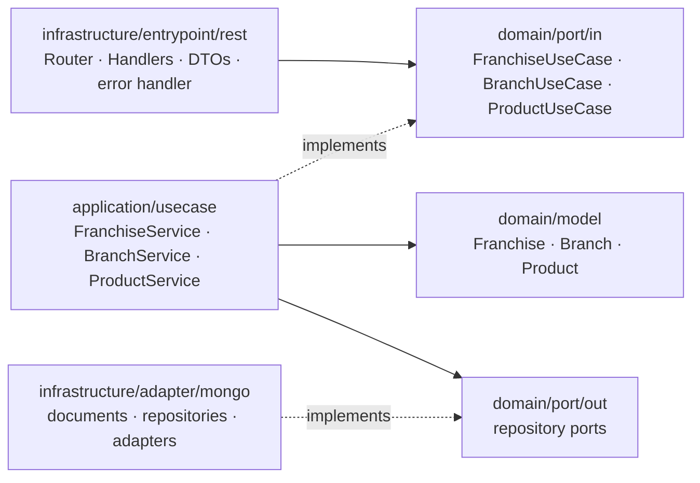

# Franquix — Franchiser as a Service

Reactive REST API for franchise networks: **franchises → branches → products with stock**.
It is built with Java 21, Spring Boot 3 (functional WebFlux) and a hexagonal architecture, and it
stores its data in MongoDB.

- Create franchises, branches and products, rename all three, update stock and delete products.
- Get the product with the most stock in each branch of a franchise.
- Every error comes back as an RFC 7807 `ProblemDetail` (400 / 401 / 404 / 409).
- Every `/api` request needs one bearer token (`API_TOKEN`).
- Tests use JUnit 5, Mockito, StepVerifier, WebTestClient and Testcontainers. JaCoCo fails the
  build below 80 % coverage.
- The repo also includes a Docker image, docker-compose, Terraform for MongoDB Atlas M0, a
  Render deployment and GitHub Actions CI.

## Architecture



- **Domain:** immutable records and ports. It has no Spring or MongoDB imports, and an ArchUnit
  test enforces that.
- **Application:** one service per aggregate (franchise, branch, product).
- **Infrastructure:**
  - REST: Router Functions and Handlers.
  - MongoDB: the reactive adapter.
  - Spring wiring: `UseCaseConfig`.
  - The bearer-token filter.

### Decisions

| Topic | Decision |
|---|---|
| Data model | Three collections with references (`franchises`, `branches`, `products`). Every write touches one small document. |
| Unique names | Unique indexes on `name`, `(franchiseId, name)` and `(branchId, name)`, declared on the documents. A duplicate returns **409**. |
| Top-stock query | Branches sorted by name, then one `findFirstByBranchIdOrderByStockDescNameAsc` per branch. Ties go to the product name in ascending order. Branches without products are left out. |
| Hierarchy | Each route checks franchise → branch → product. Any mismatch returns **404**. |
| Updates | Renames and stock changes `$set` a single field, filtered by the parent id. A deleted product is never recreated. |
| Security | One static bearer token, compared in constant time. Health checks and API docs stay public. |

## Run locally

Requirements: Docker. To run without Docker you also need JDK 17+; Gradle downloads JDK 21 itself.

```bash
docker compose up --build          # API + MongoDB on http://localhost:8080
```

Or run MongoDB in Docker and the API with Gradle:

```bash
docker compose up -d mongo
./gradlew bootRun                  # profile "local"
```

The local token is `local-dev-token` (set `API_TOKEN` to change it).

- **Swagger UI:** http://localhost:8080/swagger-ui.html. Click **Authorize** and paste the token.
- **Health check:** http://localhost:8080/actuator/health

| Variable | Default | Description |
|---|---|---|
| `MONGODB_URI` | `mongodb://localhost:27017/franquix` (local profile); required in `prod` | MongoDB connection string |
| `API_TOKEN` | `local-dev-token` (local profile); required in `prod` | Bearer token for `/api/**` |
| `SPRING_PROFILES_ACTIVE` | `local` (`prod` in Docker) | Spring profile |
| `PORT` | `8080` | HTTP port |

## API

Base path: `/api/v1/franchises`. Every request needs `Authorization: Bearer <API_TOKEN>`.

| Method | Path | Body | Success |
|---|---|---|---|
| POST | `/franchises` | `{"name"}` | 201 |
| PATCH | `/franchises/{franchiseId}/name` | `{"name"}` | 200 |
| POST | `/franchises/{franchiseId}/branches` | `{"name"}` | 201 |
| PATCH | `/franchises/{franchiseId}/branches/{branchId}/name` | `{"name"}` | 200 |
| POST | `/franchises/{franchiseId}/branches/{branchId}/products` | `{"name","stock"}` | 201 |
| PATCH | `/franchises/{franchiseId}/branches/{branchId}/products/{productId}/stock` | `{"stock"}` | 200 |
| PATCH | `/franchises/{franchiseId}/branches/{branchId}/products/{productId}/name` | `{"name"}` | 200 |
| DELETE | `/franchises/{franchiseId}/branches/{branchId}/products/{productId}` | – | 204 |
| GET | `/franchises/{franchiseId}/branches/top-stock-products` | – | 200 |

Rules:

- Names are trimmed and must be 1–100 characters.
- Stock must be an integer ≥ 0.
- Franchise names are unique, branch names are unique within their franchise, and product names
  are unique within their branch.

### curl walkthrough

The commands use bash and `jq`. [`docs/requests.http`](docs/requests.http) has the same flow for
an IDE.

```bash
API=http://localhost:8080/api/v1/franchises
AUTH='Authorization: Bearer local-dev-token'
JSON='Content-Type: application/json'

FRANCHISE=$(curl -s -X POST $API -H "$AUTH" -H "$JSON" -d '{"name":"Acme Coffee"}' | jq -r .id)
CENTRO=$(curl -s -X POST $API/$FRANCHISE/branches -H "$AUTH" -H "$JSON" -d '{"name":"Centro"}' | jq -r .id)
NORTE=$(curl -s -X POST $API/$FRANCHISE/branches -H "$AUTH" -H "$JSON" -d '{"name":"Norte"}' | jq -r .id)
COFFEE=$(curl -s -X POST $API/$FRANCHISE/branches/$CENTRO/products -H "$AUTH" -H "$JSON" \
  -d '{"name":"Coffee","stock":120}' | jq -r .id)
curl -s -X POST $API/$FRANCHISE/branches/$NORTE/products -H "$AUTH" -H "$JSON" -d '{"name":"Bagel","stock":85}'

curl -s $API/$FRANCHISE/branches/top-stock-products -H "$AUTH"      # top product per branch
curl -s -X PATCH $API/$FRANCHISE/branches/$CENTRO/products/$COFFEE/stock -H "$AUTH" -H "$JSON" -d '{"stock":15}'
curl -s -X PATCH $API/$FRANCHISE/branches/$CENTRO/products/$COFFEE/name -H "$AUTH" -H "$JSON" -d '{"name":"Espresso"}'
curl -s -X PATCH $API/$FRANCHISE/branches/$CENTRO/name -H "$AUTH" -H "$JSON" -d '{"name":"Downtown"}'
curl -s -X PATCH $API/$FRANCHISE/name -H "$AUTH" -H "$JSON" -d '{"name":"Acme Coffee Global"}'
curl -s -o /dev/null -w '%{http_code}\n' -X DELETE $API/$FRANCHISE/branches/$CENTRO/products/$COFFEE -H "$AUTH"
```

Errors look like this:

```json
{ "type": "about:blank", "title": "Conflict", "status": 409,
  "detail": "A franchise named 'Acme Coffee Global' already exists",
  "instance": "/api/v1/franchises", "timestamp": "2026-10-03T15:33:49.204Z" }
```

## Tests

```bash
./gradlew build      # all tests + JaCoCo report; fails below 80 % line or branch coverage
```

Docker must be running, because Testcontainers starts `mongo:7.0`. The coverage report is at
`build/reports/jacoco/test/html/index.html`.

| Suite | Scope |
|---|---|
| `domain/**`, `application/**` | Model rules and every use case (Mockito + StepVerifier) |
| `infrastructure/entrypoint/rest/**` | Routes, status codes, validation, errors, token filter (WebTestClient) |
| `MongoRepositoryAdaptersIT` | Adapters and unique indexes against MongoDB (Testcontainers) |
| `FranquixApiE2EIT` | The whole application over HTTP: ties, empty branches, 409s, hierarchy |
| `HexagonalArchitectureTest` | Layer dependency rules (ArchUnit) |

## MongoDB Atlas with Terraform

Terraform creates an Atlas project, a free **M0** cluster, an application user and the IP access
list. See [`infra/README.md`](infra/README.md) for details.

```bash
export MONGODB_ATLAS_CLIENT_ID=... MONGODB_ATLAS_CLIENT_SECRET=...
cd infra/envs/prod
cp terraform.tfvars.example terraform.tfvars    # set atlas_org_id
terraform init && terraform apply
terraform output -raw mongodb_uri               # value for MONGODB_URI
terraform destroy                               # remove everything
```

## Deploy to Render

[`render.yaml`](render.yaml) deploys the Docker image as a **free** web service.

1. Push the repository to GitHub.
2. In Render, go to **New → Blueprint** and select the repository.
3. Paste the Atlas `MONGODB_URI` when asked. Render generates `API_TOKEN` on its own; you can
   read it in the dashboard.
4. When the service is live, check it:
   `curl https://franquix-api.onrender.com/actuator/health`

On the free plan the service sleeps after 15 minutes without traffic. The first request after that
takes about a minute while the JVM starts.

**Public URL:** `https://franquix-api.onrender.com` (*fill in after the first deploy*)

## CI/CD

- **CI:** [`ci.yml`](.github/workflows/ci.yml) runs on every push and pull request. It runs
  `./gradlew build` with tests and the coverage gate, plus `terraform fmt -check` and
  `terraform validate`.
- **CD:** Render deploys every push to `main` once that CI run passes (`autoDeployTrigger: checksPass`).
  No deploy secrets are stored in GitHub.

## Project structure

```
src/main/java/com/franquix/franchises
├── domain/            model, exceptions, port/in, port/out
├── application/       FranchiseService, BranchService, ProductService
└── infrastructure/    rest (router, handlers, dto, errors), adapter/mongo, config, security
infra/                 Terraform for Atlas M0
docs/                  MVP spec, requests.http
Dockerfile, docker-compose.yml, render.yaml, .github/workflows/ci.yml
```
